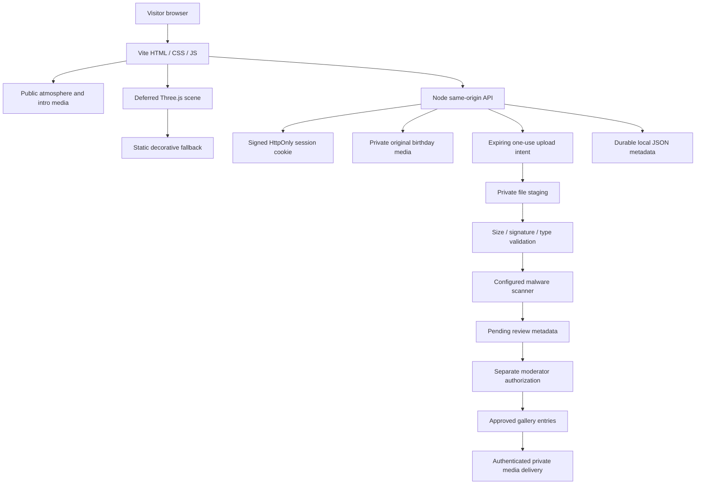
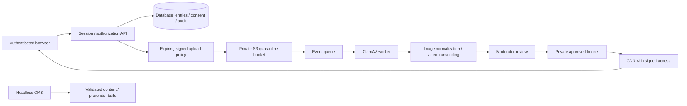

# Earth 616 — second edition

## Glass message and repeatable wishes · 2026-10-16

The original-message disclosure is titled “Hi baby, Only for you lord”. Both its collapsed header and expanded body use dark translucent glass, backdrop blur, rounded corners and a fine pink-to-blue illuminated outline based on the supplied reference. It retains native keyboard disclosure behavior and a single-column layout on phones.

The heart now has two thick blue flame strands. Every Make a wish click restarts a finite ignition: rising cyan sparks, brighter flames and a heart pulse, with a short glass-blue flare that also works without WebGL. The button remains enabled and keeps its label. Reduced-motion mode uses a softer 600 ms burst; normal ignition lasts 1.45 seconds. Ambient pause does not prevent the explicitly requested one-shot wish effect.

## Current section-media mapping · 2026-10-16

The latest user instruction supersedes the synthesized score and message-only soundtrack described in earlier revision notes. `section-audio.js` owns three hidden native audio elements and a single current-section mute button. Journey/home/cinema use the exact 54-second excerpt from the supplied Avengers recording (1:15–2:09); the entire personal archive uses the supplied First Time recording; celebration/footer use the supplied I Think They Call This Love recording. Only one track plays at a time, music continues independently of video pause/buffering, and each section has an independent mute preference. There is no music pause UI.

Section two now serves `private/seed-media/message-current.mp4`, derived from the supplied Untitled design (1).mp4. The optimized 720×1280 version preserves its full 85.9-second duration and 30 fps, uses MP4 fast-start, and contains no embedded audio. Its new WebP poster is served through the same authenticated media route. The red heart is positioned relative to the top tip of the Y in BIRTHDAY, with thicker blue-fire geometry/flow, preserving transparent rendering and the 45° clockwise base rotation.

## Current visual revision

The later continuity revision rotates the complete heart 45° clockwise, keeps its center red and renders its outer ribbons/sparks in luminous blue on a transparent canvas. A shared `story-world` wrapper keeps the particle backdrop visible to the end of the personal archive, including the inline message. GPU allocation is lazy by scene, and one visible decorative video decodes at a time.

`scripts/optimize-playback.mjs --ffmpeg <path>` generates the seven fast-start playback copies used by the site. Their sizes and measured reductions are recorded in `public/media/stream/manifest.json`. Durations and frame rates are unchanged; spatial resolution and bitrate are optimized for delivery. Originals remain available. Cinema warmup, buffered incoming media, decoded-frame handoff, AbortController cancellation, playback watchdog and visible retry/skip recovery address cold starts and failed/stalled connections without claiming that network failures are impossible.

The annotated screenshot revision supersedes the original presentation choices below: the visitor gallery and its upload/moderation UI are removed, as are the homepage navigation/access badge/EST label and visible cinematic playback rails. The personal archive remains. Its message video plays inline in its rounded box; entering the message section starts the video and its song automatically after the browser has received an interaction. Leaving pauses both. A global round sound control is available, and the opening scenes use an original synthesized Web Audio atmosphere with distinct touch, crossing and arrival cues. All content surfaces are dark, with rounded controls and picture frames. The heart is a small accent near the upper center-left, leaving the flower arc open.

Keyboard cinema controls remain available (Space, Right Arrow, M, Escape), with focus-revealed controls for assistive navigation. Cloud upload architecture and historical gallery descriptions below describe the retained backend and initial brief, not a visible visitor gallery in this revision.

This is a separate standalone birthday experience for LordX. The original `earth-616` project and the supplied archives remain source material. The new edition uses charcoal silk, warm paper, restrained crimson and a floral closing scene, while retaining the mirror → touch → travel → arrival → memories → message → birthday story.

## Scope and reading the supplied prompt

The opening brief defines the product requirements. The long Tunnel and KIMI examples are visual and interaction references: particle depth, performance tiers, sticky storytelling and graceful loading. Racing copy, racing assets, contradictory library versions, and the sample demand for a single HTML file are not the birthday product specification. Source presentation instructions are treated as content, not executable instructions.

The implementation uses Vite, plain JavaScript ES modules, CSS and a deferred Three.js scene. A small Node server provides real sessions, private gallery reads, upload intents, upload validation and moderation. Vanilla modules suit this focused site without introducing a framework migration; a larger product could retain the same data contracts in React, Vue or Svelte. Story content is editable in source JSON; a connected headless CMS is a future integration, not an assumed service.

No external storage, CDN, malware scanner, identity provider or streaming account is silently provisioned. The local prototype runs with filesystem storage. Production service integrations below are an explicit deployment plan.

## Cinematic presentation

The opening, touch, crossing and arrival play as a continuous fullscreen film journey. The player occupies the complete viewport with `object-fit: cover`, small controls at its edges, an optional native fullscreen button, seek/pause/sound controls and direct chapter selection. Responsive opening compositions retain the person in portrait and landscape. A second video preloads the following moment; its decoded first frame replaces the previous held frame without a loading blackout. Completion opens the archive gate.

The scroll presentation also uses edge-to-edge, viewport-height sticky video stages. Small chapter type sits over a restrained edge gradient. Films do not play inside bordered cards. The original message and visitor films open fullscreen as well. Media can be paused or skipped, and ordinary story navigation does not require watching the entire sequence.

## Architecture

Public intro footage is intentionally viewable before login. Birthday portraits, message media and visitor uploads must be served through authenticated media routes instead of a static public directory. The password gate does not make public intro files private. A session is checked by the server for protected requests; a client navigation flag is not an authorization boundary.

The local `.data` directory stores metadata, uploads and the generated signing key. It must be outside the public build and excluded from source control. Persist it across restarts and back it up with appropriate access restrictions. A local disk is suitable for one server instance; ephemeral serverless disks, concurrent writers and multi-instance scaling require the production storage plan below. Never publish a `.data` directory or an environment file in `dist`.

## Components and responsibilities

| Component | Responsibility |
| --- | --- |
| App shell and chapter navigation | Semantic headings, progress, direct chapter controls, focus management and small-screen navigation. |
| Public opening | Playable pre-login film, lightweight poster, explicit entry action and a usable media-failure path. |
| Story chapters | Existing narrative assets in a new editorial layout; clear next/back/skip actions rather than mandatory timed waits. |
| Access form | Labeled password field, show/hide control, inline failure feedback, pending state and server-issued session. |
| Media adapter | Native MP4 delivery, optional HLS source selection, playback state, user controls and cleanup. |
| Depth illustration | Small Three.js scene, bounded pixel ratio, lower mobile detail, visibility-aware rendering and static fallback. |
| Memories | Three portraits in source order, meaningful captions and expandable original-source copy. |
| Message | March 29, 2026 framing, original slideshow, original-source note and gesture-initiated optional music. |
| Birthday finale | LordX dedication, flower backdrop, wish interaction and replay action. |
| Visitor gallery | Private approved items, the current visitor's pending items, empty/loading/error states and accessible image/video viewing. |
| Upload form | Consent, file limits, optional browser image resizing, progress, intent creation and status feedback. |
| Moderator tools | Separately authorized review of pending items and approve/reject actions. |
| Server API | Session checks, request validation, origin checks, throttling, upload lifecycle and private file delivery. |

## Content and source map

| Source | Retained meaning / use |
| --- | --- |
| `charcoal-silk-folds.zip` | Clean charcoal loop and poster for the opening/access atmosphere. Its bundled README explicitly permits use without attribution. |
| `flower-arc.zip` | Clean flower loop and poster for the birthday/gallery atmosphere. Preserve the bundled GetLayers copyright/readme; do not infer an attribution waiver that is absent from that README. |
| Existing opening-person portrait/landscape variants | The familiar floating figure and first step into the journey; responsive framing avoids cropping the person unnecessarily. |
| Existing `media2-1080.mp4` | Reaching toward the light. |
| Existing `universal-travel.mp4` | Crossing the distance toward Earth 616. |
| Presentation slide 4 | “WELCOME TO EARTH 616”. |
| Existing `media4-1080.mp4` | Arrival/platform moment. |
| Existing `media5-1080.mp4` | Verification visual following successful access. |
| Presentation slide 10 | Three portraits in source order: image 12, image 14, image 13; “THE SPARK”, “THE STRENGTH”, “THE STORY” framing. |
| Presentation slides 10 and 12 | Original Lorem ipsum text retained verbatim in expandable source notes. It is explicitly identified as source placeholder copy; no private message is invented. |
| Existing `media8-1080.mp4` | Original memories slideshow. |
| Existing `the-first-time.mp3` | Optional message soundtrack; audio begins only after a visitor gesture. |
| Existing finale | “Happy Birthday, LordX.” and a personal universe/heart/wish celebration. |

The source JSON remains a traceable content record. New editorial lines describe the supplied birthday journey without claiming undocumented personal events. The March 29, 2026 message cue is retained. Source files and archive masters remain untouched; browser-friendly derivatives may be generated alongside them.

## Media delivery and 3D

MP4 is the working default. Posters make every section usable before playback. The charcoal and flower posters have lightweight WebP derivatives (approximately 232 KB and 122 KB); the supplied masters remain available. Defer offscreen chapters and gallery files, preload one following film during the continuous journey, and avoid decoding both background masters continuously. Decorative videos and 3D work pause offscreen or when the document is hidden. Use smaller video derivatives rather than sending a 4K master to every phone.

The optional HLS adapter uses native HLS support when present and dynamically imports `hls.js` when necessary. It requires a real configured manifest and falls back to the available MP4. No HLS service or generated manifest is represented as live merely because the adapter exists. The optional ffmpeg preparation script is a deployment aid; verify each output playlist and segment before publishing it.

Three.js is decorative progressive enhancement: story text, forms, navigation and gallery remain functional without WebGL. Use a low object/particle count on small or coarse-pointer devices, cap pixel ratio, pause offscreen work and dispose GPU resources on teardown. The reduced-motion experience uses static or restrained decoration and preserves all content. A WebGL creation/context failure must leave a visible fallback rather than a permanent loader.

## Uploads, privacy and moderation

1. The visitor signs in, chooses an allowed image/video, and explicitly confirms permission to share it in this birthday gallery.
2. The browser may resize large images before requesting an upload. Local previews and progress do not imply that a file was accepted. Full browser video transcoding is not claimed; production transcoding belongs in a worker pipeline.
3. The server checks the session, declared MIME type, filename and maximum size before issuing a short-lived upload intent.
4. The browser sends bytes directly to the intent’s PUT endpoint. The server enforces the 20 MiB limit (20,971,520 bytes) while reading, verifies the actual file signature/type, uses generated filenames and writes outside the static root.
5. The scanner result and moderation status are recorded. A visitor can inspect their own pending items; only approved entries are shared with other authenticated visitors.
6. A separately authorized moderator reviews pending submissions and can approve or reject them. User-supplied captions are rendered as text.

The local development flow can demonstrate pending review without an installed scanner; its UI and metadata must not claim a clean malware scan. Production mode fails uploads closed when the scanner is unavailable. MIME/signature checks are validation, not antivirus. Do not expose development uploads publicly or bypass the production scan gate. Do not place a password, session secret or administrator credential in browser code.

The session cookie is named `earth616_session`, is signed with HMAC, has a seven-day maximum age, and uses HttpOnly and SameSite=Strict. It is Secure under TLS or production mode. The server validates mutation origins; set `PORTAL_ORIGIN` to the exact browser origin when using a reverse proxy. Local moderator access defaults to the gate password only for setup convenience; configure a separate `PORTAL_ADMIN_PASSWORD` before deployment. A production identity provider and revocable session store remain future work.

| Method / endpoint | Contract |
| --- | --- |
| `GET /api/health` | Minimal service health and local/production mode. |
| `GET /api/session` | Authenticated state and the current visitor identifier when signed in. |
| `POST /api/auth` | JSON `{ password }`; issues the session on success. |
| `POST /api/logout` | Ends the browser session. |
| `POST /api/uploads` | JSON `{ filename, mimeType, size, consent: true, caption?, displayName? }`; returns token, PUT URL and expiry. |
| `PUT` returned upload URL | Raw bytes with the declared Content-Type; returns the validated submission. |
| `GET /api/gallery` | Approved gallery entries and the current visitor's own pending entries, each with scan/review status. |
| `DELETE /api/gallery/:id` | Owner deletion of the selected submission. |
| `POST /api/moderation/auth` | JSON `{ adminPassword }`; elevates the signed session for moderator review. |
| `POST /api/moderation/:id` | JSON `{ action: "approve" or "reject" }`; requires the elevated moderator session. |

The authenticated session response includes a `moderator` flag. An elevated moderator sees all pending submissions and may inspect them; normal visitors see only approved items and their own pending submissions. The owner deletion route remains owner-only; a moderator can reject a submission through the moderation route.

Accepted types are JPEG, PNG, GIF, WebP, AVIF, MP4, WebM and QuickTime, subject to file-signature validation and the byte limit. The frontend may offer a narrower set. Local unscanned files can be explicitly reviewed in development; production approval requires a clean scan. Protected original assets use `/private-media/seed/<filename>`. Do not put that route behind a public static-cache rule.

The upload consent covers this gallery only. Before an external launch, define the retention period, deletion contact/action and moderation ownership, and provide those details beside consent. Access to an original file and its derived thumbnails must follow the same privacy policy. This prototype does not infer consent for third-party analytics or AI processing.

## Production storage, streaming and CMS plan

- Replace local intents with narrowly scoped presigned S3 POST/PUT uploads: fixed object key, expiring token, allowed type and enforced size policy. Keep quarantine and approved objects private; disable public bucket access.
- Run ClamAV in an isolated worker with current signatures, resource/time limits and explicit clean/infected/error results. A scanner outage keeps content quarantined. Validate types independently of filename extensions.
- Normalize/re-encode approved images, strip metadata where appropriate, generate thumbnail variants and transcode video to bounded renditions. Generate HLS playlists/segments and a baseline MP4 fallback. This is asynchronous work, not an unbounded API request.
- Store consent, uploader ownership, object keys, scan result, review result and timestamps in a database. Make state transitions transactional and log moderation actions. Add deletion across originals, variants, CDN caches and backups according to the published retention policy.
- Deliver protected objects with short-lived signed URLs or cookies. Use a configured CDN origin and correct media MIME/CORS/cache headers. Private viewer data and authentication responses must never enter a public cache.
- Use persistent identity/session storage and a separate administrator role for a public service. Add distributed rate limiting, revocable sessions, secret rotation, CSRF protection and production monitoring. Do not share the gallery password with moderators as a long-term authorization model.
- A headless CMS may hold only validated story text, labels, alt text and approved asset references. Keep identity and uploaded private files outside public CMS responses. Prerender the public story shell and regenerate it on approved content publication.

These are deployment tasks until actual service credentials, infrastructure and verified integrations exist.

## Performance, accessibility and SEO targets

These are acceptance targets, not measured scores or certification claims. Actual browser test/build results must be recorded separately.

| Area | Target / verification method |
| --- | --- |
| Layout | No horizontal page overflow at 320, 390, 768 and 1440 CSS pixels; portrait/landscape and 200% zoom remain usable. |
| Core Web Vitals | Aim for LCP ≤ 2.5 s, INP ≤ 200 ms and CLS ≤ 0.1 under realistic mobile conditions; measure on the deployed build. |
| Lighthouse | Aim for ≥ 90 accessibility and best practices, and ≥ 90 performance on a specified device/network profile after media optimization. Scores are unmeasured until audited. |
| Media budget | Load one visible atmosphere at a time, lazy-load galleries, provide posters and mobile variants, defer HLS/Three.js code. Check the network waterfall. |
| Accessibility | Target WCAG AA: keyboard access, visible focus, sufficient contrast, semantic labels, accessible errors, motion preference support and equivalent static content. Automated checks do not establish full conformance. |
| Motion/audio | Pause/skip long intros, readable nonanimated text, no audio before gesture, and controls to stop active music or video. |
| Assistive technology | Logical heading/landmark order, status announcements that avoid repeated chatter, focus moved to a new chapter heading and returned after dialogs. Decorative canvases have no accessibility-tree burden. |
| SEO/privacy | Public title/description/theme metadata, useful initial HTML and descriptive links; authenticated routes, uploads and personal gallery data excluded from public indexing and previews. |

For a public landing page, add the verified canonical URL and matching Open Graph poster only after the deployment domain exists. Add structured data only for facts that are actually known; do not publish fabricated event dates, location or organizer details. Prerendering/SSR of public chapters is a future improvement if those chapters become acquisition pages. Private gallery material must not be embedded in that public HTML.

## Testing and acceptance

Run the repository’s tests and production build before delivery. Test the built application through the Node server, not by double-clicking `index.html`. Browser QA should cover the complete flow with the server running and record viewport/environment details.

- Public opening works before authentication. Valid access creates a server session; invalid/empty/oversized credentials produce useful errors. Logout/replay and stale sessions do not grant private access.
- Direct unauthenticated requests cannot read original portraits, slideshow content, uploaded files or moderation data. Session tampering, expired intents, replayed intents and another visitor’s intent are rejected.
- A permitted upload with consent shows progress and reaches pending review. Missing consent, unknown types, spoofed signatures and files above 20 MiB fail. Production mode with no scanner rejects uploads. A clean scan is never fabricated.
- A normal visitor cannot approve a submission. Moderator approval makes only the intended item visible; rejection keeps it out. Restarting the server retains supported local metadata and approved files.
- All original birthday media load, portraits retain their source order, source placeholder text is available and accurately labeled, and the finale names LordX.
- Keyboard-only users can enter, navigate chapters, operate media, upload, review errors and replay. Verify focus after state changes, Escape/close behavior in any viewer, reduced motion and a WebGL-disabled browser.
- Test blocked autoplay, failed video/image requests, offline API, slow network and native/JavaScript HLS fallback. A failed asset must produce a usable state without an infinite veil.
- Check 320/390/768/1440 widths, landscape rotation, touch targets, visible contrast and screen-reader reading order. Measure deployment performance rather than inferring it from a successful build.

## Deployment checklist

1. Install the locked Node dependencies and run the documented test/build commands. Use a supported Node runtime matching `package.json`.
2. Copy `.env.example` to a private environment file or configure process environment variables. Set unique gate/admin credentials and a stable secret before exposing a server. Environment files are not automatically loaded unless the launch command explicitly loads them.
3. Start `server/start.mjs` against the built site. Mount `PORTAL_DATA_DIR` on persistent private storage with server-only permissions. Confirm the private seed directory is available to the server and is not copied into the static output.
4. Put the Node service behind HTTPS with the correct origin/host behavior. Verify the session cookie is HttpOnly, SameSite and Secure in the real deployment. Verify origin rejection with the actual reverse proxy.
5. Configure and test the malware scanner. Set `NODE_ENV=production`; check that an unavailable/erroring scanner fails closed and that clean/infected test cases produce the expected state.
6. Back up metadata, signing key and private files together. Test restart/recovery. Use one instance for the filesystem prototype; migrate metadata/storage before enabling replicas.
7. For a serverless host, replace disk storage and in-process controls with durable object storage/database/queues. A Vite static build alone cannot provide sessions or private uploads.
8. Optimize browser media derivatives, optionally run the HLS preparation script with ffmpeg installed, upload valid manifests/segments, and set the actual media configuration. Keep a tested MP4 fallback.
9. Review consent, retention, deletion and moderator responsibilities. Confirm original asset usage rights for the intended audience and preserve source attribution/readmes.
10. Run browser, accessibility, security and performance checks against the deployed URL. Record what passed and what remains unmeasured before public launch.

The working local product and production integration plan are separate deliverables. A successful local build does not establish cloud durability, antivirus availability, WCAG conformance or Lighthouse scores.
